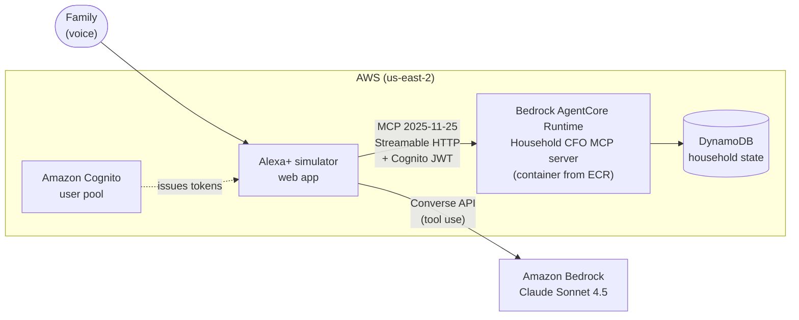

# Household CFO

An Alexa+ MCP server for running a family's money by voice.

> "Alexa, can we afford soccer camp for $240?"
>
> "You can, but it's a stretch. It puts kids over budget by $98.50. You could cover the gap from home, which has $135.75 left."

I built this for the Amazon Developer Hackathon 2026 (Alexa+ track, plus the AWS Builder and Open Source mini challenges).

## Why I built it

In our house, money questions come up in the kitchen, not at a desk. Can we do the camp? Are we eating out too much this month? What are we still paying for that nobody uses? Answering them usually means opening a laptop and a spreadsheet nobody has updated.

At the same time, voice assistants are starting to buy things for us. That's useful, but I didn't want an assistant that could spend our money just because a model decided to. So Household CFO answers questions freely, but it never buys or cancels anything without asking first.

## What you can ask

The server has five tools:

| Tool | Example | What it does |
|---|---|---|
| `budget_status` | "How are we doing this month?" | Spending against the monthly budget, overall and by category |
| `can_we_afford` | "Can we afford soccer camp for $240?" | Says yes, stretch or no. It looks at the category budget, bills due before payday and a safety cushion, and reminds you of any related family decision. |
| `make_purchase` | "Buy soccer cleats for $80." | Under $50 it just buys. Between $50 and $2,000 it asks you first. Over $2,000 it refuses. |
| `cancel_subscription` | "Cancel Peloton." | Always asks first, and tells you why it might be worth it ("not used in 74 days"). If you name something you don't subscribe to, it suggests what you could cancel. |
| `remember_decision` | "Remember, no new subscriptions until December." | Saves the decision so it comes up again later |

There's also a `weekly_checkin` prompt that puts together a short spoken review of the week from the live data.

All the data in this demo is made up: a family of four with a month of transactions. No real bank accounts are connected.

## Where the financial data comes from

Household CFO is the voice and the guardrails. It isn't meant to be another place where you type in your spending. In a real setup, it reads from wherever the family's money data already lives.

The code is built for that. The tools never talk to a bank or a database directly. They work on one `Household` object (budgets, bills, subscriptions, transactions), and a store loads it at the start of each session (`src/store.ts`). To connect a real source, you write a loader that maps that source's data into a `Household`. Nothing in the tools or the guardrails changes.

**Plugging into any PFM app or aggregator.** Household CFO can sit on top of any personal finance management (PFM) app or financial data aggregator. These already hold what it needs: categorized transactions, monthly budgets and recurring charges. A loader fetches that data for the signed-in family and fills in the `Household`. Then "Alexa, how are we doing this month?" answers from the same numbers the family already sees in their app.

One example of such an app is [XSPEND](https://xspend.io/), a personal finance and expense tracking app that I built. An XSPEND loader would let XSPEND users ask Alexa about their money, while XSPEND stays the source of truth.

**Ways to connect:**

| Source | How it would plug in |
|---|---|
| PFM apps with an API, like XSPEND | Map the app's accounts, transactions and budgets into the `Household` |
| Bank data aggregators (Plaid, MX, Finicity) | Read-only access to linked accounts. Transactions come with categories, and recurring charges can be detected for the subscription audit. |
| Open banking (FDX API, US "1033" data access rules) | The same idea, straight from the bank under the consumer's permission |

None of these need Amazon to build anything new. Plaid, MX and Finicity are existing companies that sell this access to developers, and open banking APIs are run by the banks (usually reached through one of those aggregators). Household CFO would be one more app on top: the family links their accounts once, through the provider's own sign-in screen, and the loader reads from the provider. Amazon's part is Alexa+ and the AWS services that host the server.

Whichever source is used, access stays read-only. "Buying" or "canceling" in Household CFO goes through the confirmation guardrails, and a real deployment would hand the final step to the merchant or the bank's own flow.

### What's stored in DynamoDB

In the demo there is nothing to connect to, so DynamoDB holds the whole household as one item (`pk = household#demo`): budgets, bills, subscriptions, goals, a month of transactions and the family's decisions. That's what lets a new session pick up where the last one stopped.

With a real source connected, that changes. The source stays the system of record, so Household CFO only keeps what it owns itself:

| Kept in DynamoDB | Why |
|---|---|
| Family decisions ("no new subscriptions until December") | The PFM app or bank doesn't know about these |
| Settings, like the auto-approve and hard spend limits | They belong to Household CFO's guardrails |
| A log of confirmed purchases and cancellations | So there's a record of what the assistant did and who said yes |
| A short-lived cache of this month's numbers: spent and budget per category, bills due before payday | So a voice answer doesn't wait on the source every time. It expires after a few minutes (DynamoDB TTL) and is fetched again. |

Raw transactions and account numbers are not copied into DynamoDB, and the access token for the provider would go in AWS Secrets Manager, not in the table.

## How it works



The MCP server is written in TypeScript with the official MCP SDK (1.32.1). It speaks protocol 2025-11-25 over Streamable HTTP and keeps a session per client. I kept all the money logic in plain functions under `src/finance/` with their own tests; `src/server.ts` just connects the tools to them.

Every purchase and cancellation goes through a small guard (`src/guardrails/`). If the client supports MCP elicitation, the user gets a confirm form. If it doesn't, the tool answers `needs_confirmation` with a one-time token, the assistant asks out loud, and calls again with the token once you say yes. The token only works for that exact purchase and expires after five minutes. I've published this part on its own as [mcp-guardrails](https://github.com/dharani0804/mcp-guardrails), since any MCP server that spends money could use it.

On AWS, the server runs on Bedrock AgentCore Runtime. AgentCore starts a fresh microVM for every session, so anything kept in memory disappears when the conversation ends. That's why the household lives in DynamoDB: each session loads it at the start and saves it after every change. A decision you make on Monday is still there on Thursday.

The Alexa+ developer console still says "Coming soon", so for the demo I built a simulator (`simulator/`), which the hackathon rules allow. It's a small web page: you talk, the browser turns your speech into text, Claude on Amazon Bedrock decides which MCP tools to call on the live server, and the page speaks the answer and shows an Echo Show style card. That's the same loop Alexa+ runs with an MCP server.

## AWS services

| Service | What I use it for |
|---|---|
| Amazon Bedrock AgentCore Runtime | Hosting the MCP server (MCP protocol, public endpoint, JWT authorizer) |
| Amazon Bedrock | Claude Sonnet 4.5 through the Converse API, choosing tools in the simulator |
| Amazon DynamoDB | Keeping the household data between sessions |
| Amazon Cognito | Issuing the tokens AgentCore checks on every request |
| Amazon ECR | Storing the ARM64 container image |
| AWS IAM | A narrow role for the runtime: pull one image repository, write logs, read and write one table |
| Amazon CloudWatch | Runtime logs |

## Running it yourself

You'll need Node 20 or newer.

```bash
npm install
npm test               # 66 tests
npm run dev:http       # MCP server at http://127.0.0.1:8000/mcp, data kept in memory
```

In another terminal you can call a tool directly:
```bash
export MCP_URL=http://127.0.0.1:8000/mcp
deploy/mcp-call.sh budget_status
deploy/mcp-call.sh can_we_afford '{"item":"soccer camp","amountUsd":240,"category":"kids"}'
```

The [MCP Inspector](https://github.com/modelcontextprotocol/inspector) works too: point it at `http://127.0.0.1:8000/mcp`.

### The simulator

This needs AWS credentials with access to a Claude model on Bedrock.
```bash
export AWS_REGION=us-east-2
export BEDROCK_MODEL_ID=us.anthropic.claude-sonnet-4-5-20250929-v1:0
export MCP_URL=http://127.0.0.1:8000/mcp      # or the AgentCore invocation URL
export BEARER_TOKEN=...                        # only needed for AgentCore (a Cognito access token)
npm run simulator                              # then open http://localhost:3000 in Chrome
```

### Deploying to AWS

1. Build and push the ARM64 image: `docker buildx build --platform linux/arm64 -t <account>.dkr.ecr.us-east-2.amazonaws.com/household-cfo:v2 --push .`
2. Create the IAM role from `deploy/trust-policy.json` and `deploy/execution-policy.json`, a Cognito user pool with `deploy/setup-cognito.sh`, and a DynamoDB table called `household-cfo` with a string partition key `pk`.
3. Create the runtime with `aws bedrock-agentcore-control create-agent-runtime`, using `serverProtocol=MCP`, the Cognito discovery URL as a `customJWTAuthorizer`, and the environment variable `TABLE_NAME=household-cfo`.

## Where things are

```
src/
  server.ts          the five tools and the weekly check-in prompt
  http.ts, serve.ts  the Streamable HTTP server; picks DynamoDB or in-memory storage
  store.ts           MemoryStore and DynamoStore
  finance/           budget, affordability, cash flow, subscriptions, decisions
  guardrails/        ActionGuard (also published as mcp-guardrails)
simulator/           the Alexa+ simulator: agent loop, small server, Echo Show page
deploy/              IAM policies, Cognito setup, and the mcp-call.sh helper
test/                66 tests, including HTTP sessions, the DynamoDB store and the simulator's agent loop
```

## What I'd do next

- Turn it into a real Alexa+ add-on once the developer console opens. That means replacing the demo's Cognito password sign-in with proper OAuth 2.1.
- Make answers card-aware: say which cards the numbers come from, and answer questions about a single card ("How much did we spend on the Amex?").
- Handle two people changing the budget at the same moment, using a version number and DynamoDB conditional writes.
- Connect real accounts, read-only, through a bank data provider.

## License

MIT
